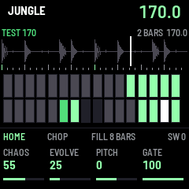
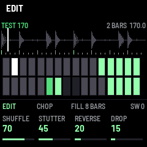
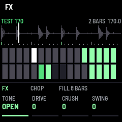

# JUNGLE

JUNGLE is a breakbeat slicer for the M-VAVE FM-1. It holds one break at a time, sent from the
[loader page](../loader/), cuts it into sixteenth-note slices and plays them back in time, rearranging them as it
goes. With CHAOS at 0 you hear the break exactly as it is; turn it up and beats get swapped, hits stutter, reverse
and drop out, and a fill comes every few bars. EVOLVE decides how fast the pattern keeps changing.

---

## 1. Loading a break

1. Install JUNGLE (the [installer](../install/)), and connect the FM-1 to the computer by USB.
2. Open the [loader](../loader/) in Chrome or Edge, press **Connect** and allow MIDI.
3. Drop a break in. The page trims the silence before it, works out whether it is 1, 2 or 4 bars and its tempo, and
   moves each slice onto the hit nearest to it. Check the picture: drag the green handles to trim, click a slice to
   hear it, shift-click the snare if the orange one is wrong (the fills use it). Type a tempo if it guessed wrong.
4. **Send to FM-1**. The screen shows ERASING, then LOADING. The break stays in the flash through power-off.

The flash holds 272 KB of samples: 3.1 s at 44.1 kHz, 4.3 s at 32 kHz, 6.3 s at 22.05 kHz, 8.7 s at 16 kHz. *Auto*
picks the highest rate that fits; four bars of a slow break go down to 16 kHz, which suits jungle anyway.

Sending new slices or a new snare for the same audio only rewrites the header, at once.

## 2. The screen

From the top: the tempo (EXT when a MIDI clock drives it; WAIT while it waits for one; FILL during a fill), the break
(its name, bars, own tempo), its waveform with a tick per slice and the playhead, then the pattern: a cell per step,
a row per bar.

- a dim cell: the step plays its own slice
- a bright cell: another slice (shuffled), or pitched
- an amber cell: reversed
- notches: retriggered (a stutter)
- empty: a rest
- white: the step playing now

At the bottom, the page's four knobs.

## 3. Controls

| Control | What it does |
| --- | --- |
| PLAY | Start / stop. With a MIDI clock coming in it waits for the clock |
| HOME · EDIT · FX | The pages of K1–K4 |
| K1–K4 on HOME | **CHAOS** how much is changed · **EVOLVE** how often a beat of the pattern is drawn again, each time around · **PITCH** in semitones · **GATE** how much of each slice plays |
| K1–K4 on EDIT | What CHAOS does: **SHUFFLE** beats and half-beats from elsewhere · **STUTTER** retriggers and repeats · **REVERSE** · **DROP** rests |
| K1–K4 on FX | **TONE** a low-pass (100 = open) · **DRIVE** · **CRUSH** fewer bits and a lower rate · **SWING** |
| SELECT | Tempo |
| ALGO | Fills: off, or every 16, 8, 4 or 2 bars |
| PRESET | Swing |
| SEQ | CHOP (slices keep their pitch at any tempo) or SPEED (the break repitched to the tempo, like a sampler running it faster) |
| REC | A new pattern from the next beat |
| ARP | A fill now, while held |
| GLO | Tap tempo |
| SEL | Back to the break's own tempo |
| OCT− / OCT+ | Tempo −1 / +1 BPM (held: repeats) |
| SAVE | Keep the knobs and the tempo (lit when there is something to save) |
| White keys | While held, play on from that sixteenth of the bar (of the break, spread over its length) |
| Black keys | While held: repeat 4 steps · repeat 2 · repeat 1 · roll · reverse · octave down · octave up · tape stop · mute · fill · straight (the break as it is) |

The white key under the slice playing lights up, so the keys show where in the break it is.

## 4. MIDI and audio

- **Clock in** (USB or the TRS jack): JUNGLE follows it. MIDI start begins on the next clock, at the top of the
  break; stop stops; continue carries on.
- **Notes**: 36–51 play the white keys, 60–70 the black keys.
- **CC**: 20–31 are the twelve page knobs (HOME, then EDIT, then FX), 14 the tempo (60 + value).
- **USB audio**: the FM-1 is an audio input on a computer, phone or tablet, as with fm1-base's other firmwares.

## 5. Troubleshooting

- *The loader finds no FM-1*: is JUNGLE installed (its name on the splash)? Is the page in Chrome or Edge, and MIDI
  allowed? Close other apps that hold the FM-1's MIDI port.
- *NO BREAK after loading*: the upload did not finish (the header is written last, so a broken one is never
  played). Send it again.
- *It drifts from the DAW*: send MIDI clock, or set the exact tempo with SELECT.
